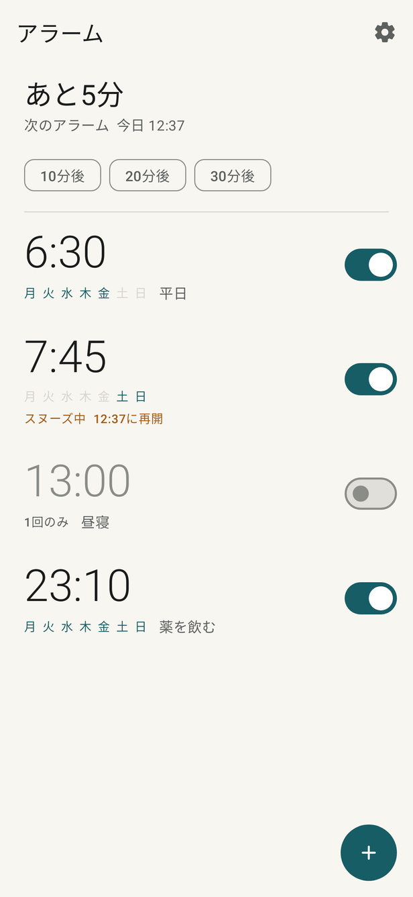
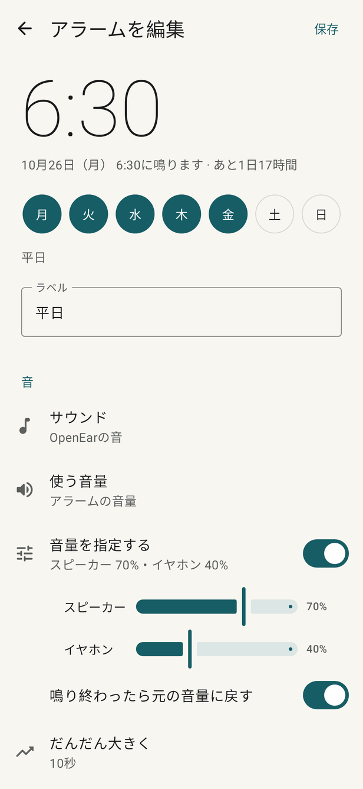
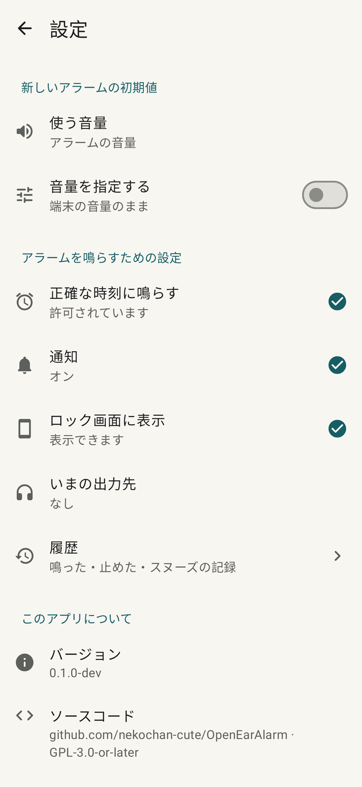
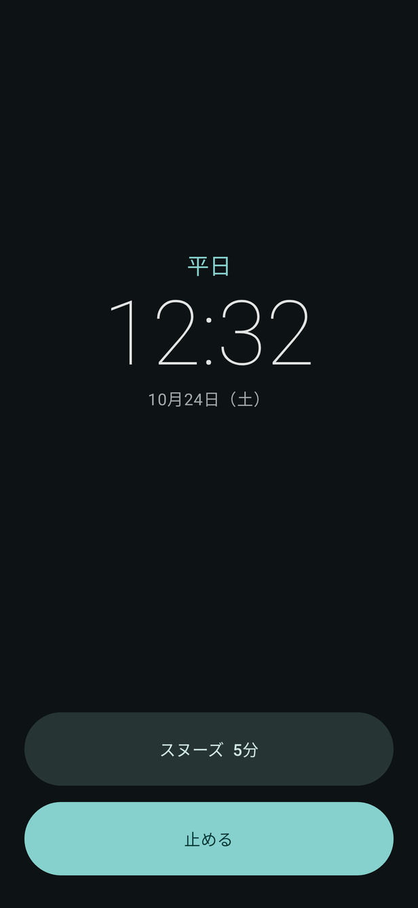

# OpenEar Alarm

イヤホンがつながっていればイヤホンで、つながっていなければ本体スピーカーで鳴るAndroidのアラームです。鳴っている途中でイヤホンが外れた場合も、スピーカーに切り替えて鳴らし続けます。

GPL-3.0-or-later。広告・アカウント・分析・ネットワーク権限はありません。

[English](README.md)

<p>




</p>

## 機能

- 1回だけ・曜日ごとのアラーム、10・20・30分後のタイマー、次のアラームまでの残り時間の表示。
- サウンド：アプリ内蔵の音、端末のアラーム音、任意の音声ファイル。再生できない音は内蔵の音に切り替わります。
- イヤホン優先：有線・USB・Bluetoothのイヤホンがつながっている間はイヤホンで鳴らし、外れたらスピーカーに切り替えます。
- 出力先ごとの音量：アラームごとにスピーカーとイヤホンの音量を指定できます。Androidは出力先ごとに音量を持っているため、イヤホンが外れた時点でスピーカーの音量に切り替わります。止めたときは元の音量に戻します。
- 使う音量（アラーム／メディア）、だんだん大きく、バイブレーション、スヌーズの間隔と回数、自動で止めるまでの時間。
- ロック画面の鳴動画面と、止める・スヌーズのボタン付き通知。鳴動画面にはイヤホンとスピーカーのどちらで鳴っているかを表示します。
- 再起動後（ロック解除前を含む）、日時・タイムゾーンの変更後、アプリ更新後もアラームとスヌーズを登録し直します。
- 設定画面で、アラームに必要な許可（正確なアラーム・通知・ロック画面への表示）の状態を確認し、その場で許可できます。鳴った・止めた・スヌーズの履歴を端末内に記録します。

## ダウンロード

[CIの実行結果](https://github.com/nekochan-cute/OpenEarAlarm/actions/workflows/android.yml)のArtifactsにある`OpenEarAlarm-debug.apk`を選ぶと、APKファイルのままダウンロードできます。debug署名の鍵は実行ごとに作られるため、別の実行のAPKを入れるときは一度アンインストールしてください。

## ビルド

JDK 17とAndroid SDK（platform 36）が必要です。Gradle 8.13はWrapperが取得します。

```sh
./gradlew :app:assembleDebug          # app/build/outputs/apk/debug/app-debug.apk
./gradlew :app:testDebugUnitTest      # JVM・Robolectricのテスト
./gradlew :app:connectedDebugAndroidTest   # 端末またはエミュレーター
./gradlew :app:testDebugUnitTest --tests '*ScreenshotTest*' -Pscreenshots   # 画面のPNGをbuild/screenshotsに出力
```

CIでは、APKのビルド、単体テスト、Android Lintに加え、Android 9・15・16のエミュレーターで端末テストを実行します。

## 仕組み

予約・再生・出力先・保存の仕組みは [docs/DESIGN.md](docs/DESIGN.md)、実機での確認項目は [docs/QA.md](docs/QA.md) にまとめています。

## ライセンス

GNU General Public License version 3 or later（[LICENSE](LICENSE)）。内蔵のアラーム音はアプリが生成します。同梱のMaterialアイコンはApache-2.0です。
